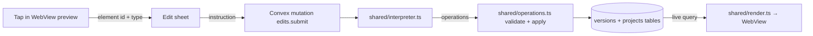

# Direct

Direct is an iOS-first visual editor for apps: open an app, tap any part of its interface, and say what should change. The interface itself is the prompt.

This repository holds the Direct MVP: an Expo (React Native) app backed by Convex, seeded with two working demo apps (Bloom, a habit tracker, and Daybook, a personal dashboard).

## The flow

1. **Home** lists your apps with live miniature previews.
2. **Open an app** to use it full-screen: habits check off, the progress bar fills, the focus timer runs.
3. **Edit** turns on tap-to-select. The tapped element gets an outline, handles, and its type (Button, Heading, Card…).
4. **Describe a change** in the bottom sheet, or pick a suggestion. Direct turns the instruction into validated edit operations, applies them to the app's component model in Convex, and the preview re-renders with the changed element highlighted.
5. **Every change is a version.** Undo steps back to the previous version; History lets you jump to any earlier version or reset to the original.

## How it works



| Layer | Where | What it does |
| --- | --- | --- |
| Project representation | `shared/model.ts`, `shared/templates.ts` | A typed component tree (screen, header, heading, text, button, card, section, progress, list item, stats). Every node has a stable id. |
| Rendering | `shared/render.ts`, `shared/preview.ts` | Turns the tree into HTML/CSS inside a WebView, plus a small runtime that makes the demo apps interactive and reports taps back to React Native in Edit mode. |
| Edit operations | `shared/operations.ts` | The only way a project changes: `setText`, `setStyle` (allowlisted properties with range-checked values), and `move` (reorder among siblings). Every operation is validated before it is applied. |
| Instruction interpreter | `shared/interpreter.ts` | Turns the selected element, the instruction, and the app's structure into operations. |
| Persistence | `convex/` | Projects, the current document, and an append-only version history. `edits.submit` interprets, validates, applies, and commits a version in one transaction. |
| Mobile UI | `src/` | Expo Router screens: home dashboard, full-screen preview/editor, edit sheet, history. |

### About the instruction interpreter

No AI model credentials are configured for this project, so **instructions are interpreted by a deterministic, rule-based parser, not by an AI model.** It runs server-side in the `edits.submit` Convex mutation and understands:

- text changes: `Change this heading to 'My Daily Goals'`, `Rename to "Stretch"`
- colors by name or hex, with light/dark modifiers, routed to fill, text, or accent by element type: `Make this button purple`, `light blue background`, `white text`
- size: `bigger`, `much smaller`, `24pt`
- weight and alignment: `bold`, `center it`
- spacing: `more padding`, `more space between items`, `tighter`
- corners: `rounded corners`, `make it a pill`, `square corners`, `radius 12`
- reordering: `move this up`, `move to the top`, `move this section above the progress bar`
- scoping to a parent: tapping a heading inside a card and saying `give this card rounded corners` edits the card

Instructions it can't map return a friendly message and create no version. Because the interpreter only emits operations and `applyOperations` validates every one, a model-backed planner can replace it later (for example a Convex action that calls a model with the element metadata and the app's structure and returns the same operation JSON) without touching rendering or persistence.

## Running it

Requirements: Node 20+, and a Convex deployment.

```sh
npm install
npx convex dev            # signs in or uses CONVEX_DEPLOY_KEY, deploys convex/, writes .env.local
npx expo start            # needs a development build (react-native-webview is native)
```

`.env` points the app at the shared dev deployment (`EXPO_PUBLIC_CONVEX_URL`); `.env.local` written by `convex dev` overrides it. The app seeds the two demo projects on first launch.

Build a simulator app without a Mac-side Expo setup:

```sh
npx expo prebuild --platform ios
cd ios && pod install && cd ..
xcodebuild -workspace ios/Direct.xcworkspace -scheme Direct -configuration Release \
  -sdk iphonesimulator -destination 'generic/platform=iOS Simulator' -derivedDataPath ios/build CODE_SIGNING_ALLOWED=NO
```

Checks: `npm run typecheck`.

## Scope and limits

- Single shared workspace: there is no sign-in, so every device sees the same projects.
- Editing is limited to the component types and style properties above; adding or deleting components, images, and navigation between screens are not supported yet.
- In-app state of the demo apps (checked habits, timer) is local to the preview and resets when the project reopens; edits and versions persist in Convex.
