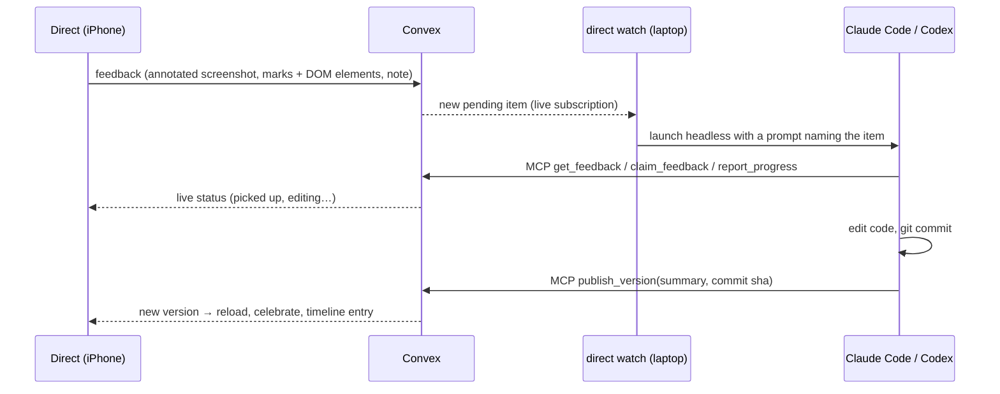

# Direct

Direct is a feedback and review layer for apps you build with coding agents. Open your app's live web preview on your phone, draw on it to show what should change, and Direct hands that to the project's agent (Claude Code, Codex, or any MCP-capable agent). The agent edits the code, commits, and publishes a version; your phone reloads the app and adds it to the timeline.

Direct captures intent and shows results. It never edits code itself.



## Pieces

| Piece | Where | What it does |
| --- | --- | --- |
| Mobile app | `src/` | Expo Router iOS app: project dashboard with live previews, full-screen live WebView, annotation overlay (draw, circle, arrow, text notes; tag marks Change / Broken / Keep), live agent status, version timeline with before / summary / after / commit. |
| DOM hit-testing | `src/components/LiveApp.tsx` | Script injected into the WebView. For every mark it finds the elements underneath and records selector, tag, text, and computed styles. |
| Backend | `convex/` | Projects, feedback items with a status history (pending → claimed → working → published / failed), versions, and image storage. Agent-facing functions (`convex/agent.ts`) require the project key, stored only as a SHA-256 hash. |
| MCP server | `cli/mcp.ts` (`direct mcp`) | Stdio MCP server scoped to one project: `list_pending_feedback`, `get_feedback` (includes the annotated image), `claim_feedback`, `report_progress`, `publish_version`. |
| Watcher | `cli/watch.ts` (`direct watch`) | Runs beside the project repo, subscribes to pending feedback, and launches the configured agent headless for each item. |
| Sample apps | `examples/` | Bloom (habit tracker) and Daybook (dashboard), plain HTML/CSS/JS. `examples/setup.sh` copies one into its own git repo. |

## Connect a project (laptop)

Requirements: Node 20+, git, and Claude Code (`claude`) or Codex (`codex`) signed in.

```sh
# once: install the CLI from this repo
git clone https://github.com/DorianGulley/DrawAgent.git && cd DrawAgent && npm install && npm link

# optional: a sample app with its own git history
examples/setup.sh habits ~/direct-apps/bloom
cd ~/direct-apps/bloom && node serve.mjs . 4173 &

# expose it so your phone can reach it (any tunnel or deployed preview URL works)
npx cloudflared tunnel --url http://localhost:4173     # prints https://<random>.trycloudflare.com

# register it; writes .direct.json (holds the project key; keep it out of git)
direct init --url https://<your-preview-url> --name Bloom --emoji 🌱 --agent claude   # or --agent codex

# run the watcher; leave it open
direct watch
```

The project shows up in Direct on the phone right away.

### What `direct watch` runs

It only ever launches the configured agent command; it never executes anything the agent or the feedback produces. Each run gets the Direct MCP server injected for that one invocation, so no global setup is needed:

- **Claude Code:** `claude -p "<prompt>" --mcp-config '{"mcpServers":{"direct":{…}}}' --permission-mode acceptEdits --allowedTools mcp__direct "Bash(git add:*)" "Bash(git commit:*)" …`
- **Codex:** `codex exec --sandbox workspace-write --add-dir <repo>/.git -c approval_policy="never" -c mcp_servers.direct.command=… -c mcp_servers.direct.args=[…] "<prompt>"`

To use a different agent, set `"command": ["my-agent", "--flag", "{prompt}"]` in `.direct.json`. `direct setup claude|codex` prints the exact command and prompt for your machine.

### Using Direct from an interactive agent session

```sh
direct setup claude   # prints: claude mcp add direct --scope local -- node …/bin/direct.mjs mcp --config …/.direct.json
direct setup codex    # prints: codex mcp add direct -- node … (and the ~/.codex/config.toml block)
```

Then ask the agent "check Direct for feedback". It can list, claim, and publish the same way.

## Make mode (on the phone)

Next to connected apps, Direct can make three kinds of things itself: **apps**, **lock screens**, and **logos**. Each starts from a template in a gallery (never a blank canvas) and is edited by tapping parts of it.

- **Kinds** live in one registry, `shared/kinds.ts`: canvas size and layout, phone/lock-screen/artboard chrome, which changes are allowed, templates, and export. A new kind is a registry entry plus templates in `shared/templates.ts`; the renderer, bridge, interpreter, and Convex pipeline are shared.
- **Selecting:** tap a thing to open the sheet. While the sheet is open, taps add or remove things. Press and hold to pick every sibling of the same type. The scope control switches between *Just this*, *All like it*, and *Everything*. The sheet shows the values the selection shares and says "Mixed" where they differ.
- **Changes** are operations with `targets: string[]` (`shared/operations.ts`). One action, however many things it touches, is one entry in history and one tap of undo. After changing one thing that has siblings, Direct offers "Apply to the other N?", which is recorded as its own step.
- **Everything** scope ("make the whole thing feel warmer", "tighten all the spacing", "match my style") produces a preview with *Keep it* / *Discard*. Nothing is saved until you keep it, and keeping is one step in history.
- **Your style** (`shared/style.ts`): every kept change is tallied per device (corners, padding, spacing, heading weight, accent color, card color). The profile is the median (numbers) or most frequent value (colors, weight), with choices you set yourself taking priority. It feeds the sheet's swatches, the "Use my style" button, defaults for vague instructions ("rounder" goes to your usual radius), and new designs, which start in your style. Instructions with explicit values always win. The *Your style* screen lists each preference in plain words; each can be changed or forgotten, and there is a reset.
- **Export:** lock screens save to Photos at screen resolution; logos save as PNGs with a clear background.
- **Storage:** Convex tables `designs`, `designVersions`, and `styleMemory`. The device keeps a random key in the iOS keychain (expo-secure-store); Convex stores only its hash. There are no accounts.

### The interpreter is deterministic

`shared/interpreter.ts` does not call a language model. It is a rule-based parser over the design's full structure and recent history. It understands text changes, colors (named or hex, light/dark), size, weight, alignment, spacing, corners, moving things ("move this above the progress bar"), references to things that aren't selected ("match the header", "use the same green as the buttons"), "do the same" (replays the last change on the new selection), and the whole-design phrases above. Anything else gets a plain message suggesting what to try. The server re-validates every operation (`applyOperations`) before saving, so the client cannot store arbitrary content.

## Security model

- The phone never sees project keys. Keys are generated once by `direct init`, kept in `.direct.json` on the laptop, and stored server-side only as a hash.
- Everything the agent sends (summaries, progress messages, URLs, commit SHAs) is validated and length-limited server-side, and rendered as plain text on the phone.
- Feedback is presented to the agent as a change request, not as commands. The MCP server only reads an after-screenshot from inside the project directory.
- There is no user sign-in yet, so anyone with the app can see and comment on every project in the deployment, and anyone with the CLI can register a project.

## Developing Direct

```sh
npm install
npx convex dev            # deploys convex/ (uses CONVEX_DEPLOY_KEY when set)
npm run typecheck         # app + CLI
```

The app needs a native build (WebView, SVG, view-shot). To build a simulator app:

```sh
npx expo prebuild --platform ios && (cd ios && pod install)
xcodebuild -workspace ios/Direct.xcworkspace -scheme Direct -configuration Release \
  -sdk iphonesimulator -destination 'generic/platform=iOS Simulator' -derivedDataPath ios/build CODE_SIGNING_ALLOWED=NO
```

`.env` points the app at the shared dev deployment (`EXPO_PUBLIC_CONVEX_URL`); the CLI uses the same deployment by default (override with `DIRECT_CONVEX_URL` or `--convex`).
